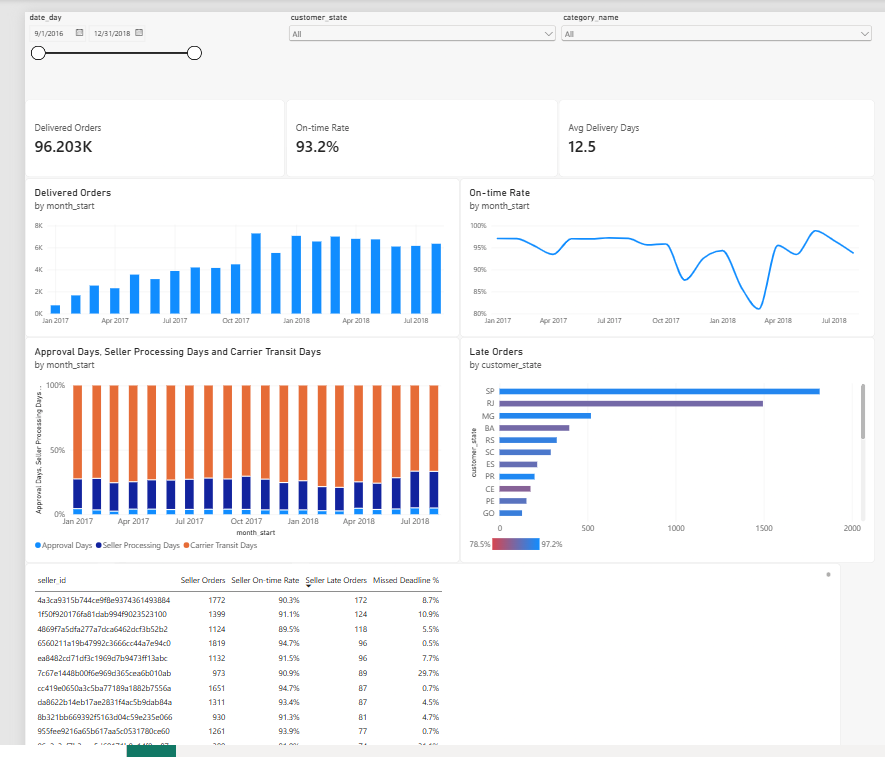

# Supply Chain Analytics


End-to-end fulfillment analytics on 100k Olist e-commerce orders: a tested cloud data
warehouse, delivery-performance analysis, dashboards in three tools, predictive models,
an experiment design and a text-to-SQL assistant, all answering one question for a Head of Operations: **how reliably do we deliver
on our promise, and what should we change?**

## The business problem

On an e-commerce marketplace, what customers remember is whether the package arrived
when promised. Every order leaves a trail of timestamps — purchase, approval, handoff
to the carrier, delivery — compared against the date the customer was promised. This
project turns that trail into trusted metrics, explains where and why orders run late,
connects delivery performance to customer satisfaction and repeat purchases, predicts
which orders are at risk, forecasts demand, groups sellers by how they fail, designs a
test of a fix, and lets managers query the warehouse in plain English.

Stakeholders, questions in scope, data limits, and every analysis decision are recorded
in the **[scoping document](docs/scoping.md)**.

## Dataset

[Brazilian E-Commerce Public Dataset by Olist](https://www.kaggle.com/datasets/olistbr/brazilian-ecommerce)
— about 99k real orders placed between 2016 and 2018, across nine linked tables
(orders, items, customers, sellers, products, payments, reviews, geolocation, category
translation). Licensed CC BY-NC-SA 4.0 by Olist.

## Architecture

```
Kaggle CSVs ──► BigQuery (olist_raw) ──► dbt: staging ──► intermediate ──► marts ──► SQL analysis
                 all columns STRING        cast & rename    business logic    star schema   dashboards
                                                                                  │        Excel workbook
                                                                                  ├──► ml ──► prediction, forecast, segmentation
                                                                                  └──► text-to-SQL assistant (OpenAI)
```

| Layer | Models | Purpose |
|---|---|---|
| Raw | 9 tables in `olist_raw` | Loaded by [`scripts/load_raw.py`](scripts/load_raw.py) with every column as STRING, so nothing is altered on the way in (e.g. leading zeros in zip codes survive) |
| Staging | 9 `stg_` views | One model per source table: types cast, columns renamed, nothing else |
| Intermediate | `int_orders_enriched`, `int_order_reviews_latest`, `int_geolocation_by_zip` | Stage durations, lateness, on-time and timeline-validity flags, review deduplication, coordinates per zip |
| Marts | `fact_orders`, `fact_order_items`, `dim_customers`, `dim_sellers`, `dim_products`, `dim_date` | Star schema read by analysis and dashboards — see the **[ERD](docs/ERD.md)** |
| ML | `ml_late_delivery_features`, `ml_weekly_demand`, `ml_seller_features` | Model inputs: approval-time features per order; weekly order counts for 6 series; one row per seller with volume, reliability, speed and reviews |

**Stack:** Google BigQuery · dbt Core · SQL · Python (pandas, scikit-learn, statsmodels) ·
GitHub Actions · Tableau · Power BI · Excel · OpenAI API

## Data quality

Data quality is enforced by dbt tests that run on every push through GitHub Actions
(keyless authentication via Workload Identity Federation — no service account keys).

- **Generic tests** — uniqueness and not-null on every primary key, accepted values for
  order status and review scores, and `relationships` tests on every foreign key in the
  star schema.
- **Custom timeline tests** — no delivery before purchase; no negative stage durations;
  and a threshold test that monitors known timeline anomalies (warns above 1,500 orders,
  fails above 3,000).
- **Grain checks** — row counts in the marts match the raw source exactly
  (99,441 orders, 112,650 items), confirming no joins fan out or drop rows.

Issues found and how they are handled:

| Issue | Orders | Handling |
|---|---|---|
| Handed to carrier before approval (incl. 166 before purchase) | 1,359 | Flagged; excluded from stage durations, kept for on-time rate |
| Delivered before carrier handoff | 23 | Same as above |
| Marked delivered but no delivery date | 8 | Excluded from delivery metrics |
| Still "in progress" months after their estimated date | 1,728 | Treated as failed fulfillments in the failure rate |
| Multiple reviews for one order | — | Latest review kept per order |
| Thin data in 2016 and Sep–Oct 2018 | 349 | Analysis window set to Jan 2017 – Aug 2018 (99.6% of orders) |

## Analysis

Sixteen SQL analyses in [`sql/analysis/`](sql/analysis/) answer the Head of Operations'
questions on fulfillment performance (01–11) and on customer experience and business
metrics (12–16); query 17 sets the baselines for the experiment design. Every metric follows the written
**[metric definitions](docs/metric_definitions.md)**, and every result is summarized in
**[FINDINGS.md](sql/analysis/FINDINGS.md)**.

| Area | Queries |
|---|---|
| Delivery promise | 01 on-time rate by month · 02 estimate accuracy by state |
| Fulfillment stages | 03 stage durations · 04 which stage makes orders late · 05 seller deadline misses |
| Geography and distance | 06 performance by customer and seller state · 07 distance effects |
| Sellers and products | 08 seller scorecard · 09 product weight and category · 10 Black Friday seasonality · 11 stuck orders |
| Customers and business | 12 reviews vs lateness · 13 monthly GMV and AOV · 14 revenue vs delivery · 15 repeat purchases (with significance test) · 16 cohort retention |

## Key findings

- **Customers punish broken promises, not slow delivery.** Review scores stay around
  4.1–4.3 while orders arrive early, then lose about half a star per day late: by 3 days
  late, half of all reviews are 1–2 stars.
- **About 7% of delivered orders arrive late, and a further 1.7% of orders never arrive.**
  Counting stuck orders, about 91.6% of promises are kept, not the headline 93.2%; the
  true fulfillment failure rate is 3.0%, not 1.2%.
- **Carriers cause most of the delay; sellers tip orders over the edge.** 87% of the extra
  time in late orders is carrier transit, while a missed seller shipping deadline makes an
  order about 4× more likely to be late.
- **Lateness depends on *where* and *when*, not *what*.** Destination state and purchase
  month swing the on-time rate by 18–19 points; product weight and category by 3–4.
- **Half of all late orders go to two states.** Rio de Janeiro, the second-largest revenue
  state, is 87.9% on time vs São Paulo's 95.5%, and distance does not explain the gap.
- **The delivery promise is badly calibrated:** 79% of orders arrive a week or more early,
  yet the Northeast has the worst on-time rates in the country.
- **Almost no one buys twice** (2% within six months). Late first deliveries point toward
  fewer repeat purchases, but the difference is not statistically significant
  (p = 0.10). Delivery pays off mainly through reputation.

## Dashboards and operations workbook

The same metric definitions are implemented in three tools, and each was checked against
the warehouse before use (96,203 delivered orders, 93.2% on time and 12.5 average
delivery days in the analysis window; Rio de Janeiro 12,310 orders, 87.9% on time,
1,495 late).

- **Tableau** (published on Tableau Public)
  - **[Operations Overview](https://public.tableau.com/app/profile/justin.bigishiro/viz/OlistOperationsDashborad)** — KPIs, monthly trend, fulfillment-stage
    breakdown and late orders by state, with date, state and category filters.
  - **[Seller Scorecard](https://public.tableau.com/app/profile/justin.bigishiro/viz/OlistOperationsDashborad)** — sellers with 50+ delivered orders, ranked by
    late orders, with on-time rate, missed-deadline rate and reviews.
  - Mart tables are exported for Tableau Public with
    [`scripts/export_marts.py`](scripts/export_marts.py).
- **Power BI** — **[Operations Overview](dashboards/olist_operations.pbix)**, connected
  directly to BigQuery. A single star-schema model (five relationships, one bidirectional
  link between items and orders) lets the date, state and category slicers filter every
  visual on the page, including the seller table.
- **Excel** — **[Operations workbook](dashboards/olist_operations_workbook.xlsx)**, built from
  [`scripts/export_excel_data.py`](scripts/export_excel_data.py):
  - *Seller Scorecard* — pivot table of orders, late orders, on-time %, missed-deadline %
    and reviews per seller; seller city and state looked up from the Sellers sheet with
    `XLOOKUP`; an action column that flags sellers who miss 15%+ of deadlines for coaching.
  - *State On-time* — spilling `SUMIFS` formulas with an order-level flag so multi-seller
    orders are counted once; color scale and data bars.
  - *Weekly Summary* — a one-page report: pick a week from a dropdown and the KPIs,
    week-over-week change and the five sellers with the most late orders update
    automatically. Checked against the Black Friday week (2,915 orders, 503 late, 82.7%).



## Predictive analytics: late-delivery risk at approval time

**[Notebook](notebooks/late_delivery_model.ipynb)** · features from
`ml_late_delivery_features` (96,189 delivered orders, 6.8% late).

- **No leakage:** only information available when an order is approved is used — the
  delivery promise, route and geography, order contents, and the seller's track record
  computed only from orders *delivered before* this order's approval.
- **Time-based validation:** train Jan–Dec 2017 (5.7% late) · validation Jan–Mar 2018
  (12.9% late, the carrier crisis) · test Apr–Jul 2018 (4.0% late). August 2018 is
  excluded because it was incomplete at extraction.

| Test set (Apr–Jul 2018) | ROC AUC | PR AUC | Late orders caught in top 10% of risk |
|---|---|---|---|
| Random | 0.50 | 0.040 | 10% |
| Baseline: seller's past late rate | 0.548 | 0.048 | 17% |
| **Logistic regression** | **0.734** | **0.106** | **32%** |

- Logistic regression beat gradient boosting on validation (PR AUC 0.285 vs 0.213): the
  simpler model generalized better to the 2018 distribution shift.
- **Strongest warning signs** (permutation importance): the delivery promise — orders
  promised more than about four weeks are roughly half as likely to be late — then
  geography (distance, same-state, customer and seller state), then the seller's history
  of missed shipping deadlines. Product category, weight and value matter little,
  consistent with the SQL analysis.
- **Use:** most lateness arises in carrier transit after approval, which no approval-time
  model can see. The model suits low-cost actions — proactive delay messages, seller
  follow-ups — not expensive ones such as upgrading shipping for every flagged order.

## Demand forecasting

**[Notebook](notebooks/demand_forecast.ipynb)** · weekly orders from `ml_weekly_demand`
(86 weeks, Jan 2017 – Aug 2018) for all orders and the top 5 categories.

- **Walk-forward evaluation** over the last 26 weeks: each forecast uses only the weeks
  before it. Methods were **selected** on Mar–May 2018 and **reported** on Jun–Aug 2018, so
  the reported error isn't tuned on the weeks it is measured on.
- Baselines: last week, 4-week average, same week last year. Models: simple and damped
  exponential smoothing. Metric: WAPE.

| Horizon | Result |
|---|---|
| **1 week ahead** | Exponential smoothing beats the best baseline in **all 6 series** (average WAPE 0.228 vs 0.264). For total orders: **0.162 vs 0.222, 27% less error** |
| 4 weeks ahead | No model beats the 4-week average (WAPE 0.263). A method that won on the selection weeks lost on the report weeks, so the difference was noise |

**Use:** a one-week-ahead forecast is worth giving sellers and carriers for capacity
planning; for a month ahead, the 4-week average is as good as anything this data supports.

## Seller segmentation

**[Notebook](notebooks/seller_segmentation.ipynb)** · 803 sellers with 20+ delivered orders
(88% of orders), k-means on log volume, missed-deadline rate, on-time rate, log processing
days and review score. k = 5: the best silhouette among k ≥ 3 (0.263), and every segment
maps to a distinct action. Sellers flagged in the SQL scorecard land where expected.

| Segment | Sellers | Share of orders | Profile | Action |
|---|---|---|---|---|
| Core high-volume | 167 | **59%** | Median 186 orders, 93.9% on time | **Protect:** carrier capacity, peak planning |
| Reliable small sellers | 320 | 18% | Best on every measure: 96.6% on time, 2.9% missed deadlines, review 4.38 | **Promote:** placement, growth incentives |
| Ship on time, arrive late | 135 | 7% | Hand off in 2.1 days, yet 88.6% on time and review 3.93 | **Fix the carrier leg and estimates**, not the seller |
| Slipping on deadlines | 134 | 11% | 20.4% missed deadlines | **Coach:** reminders, handling-time review |
| Chronic late shippers | 47 | 5% | 38.2% missed deadlines, 6.9 processing days, review 3.56 | **Intervene:** performance plan |

**Root cause of "ship on time, arrive late":** not geography (same distance and customer mix
as other segments). These orders spend the longest time with the carrier (10.6 vs 8.7 days)
and are promised the shortest window (23.6 vs 25.4 days). A scorecard based only on on-time
rate would blame these sellers for a problem they don't cause.

## Experiment design: proactive delay notification

**[Design document](docs/experiment_design.md)** · baselines from
[`17_experiment_baseline.sql`](sql/analysis/17_experiment_baseline.sql) · sample size in
[the notebook](notebooks/experiment_design.ipynb).

- **Trigger:** order not yet delivered 2 days before its estimated date. It flags 11% of
  orders (176 a week), **76% of which end up late**, and it catches every late order.
- **Treatment:** an apology and a revised date. **Control:** today's experience. Randomized
  50/50 by customer.
- **Primary metric:** share of 1–2 star reviews among triggered orders (baseline **52.4%**, vs
  9.6% for all other orders). **Guardrails:** review rate, cancellations, and satisfaction of
  triggered orders that arrive on time anyway.
- **Sample size:** α = 0.05, power 0.80, minimum detectable effect **5 points** (52.4% → 47.4%):
  **1,596 orders per arm, about 18 weeks** at 2018 volume. A 7.5-point MDE would take 8 weeks.
- Why not test a shorter delivery estimate? Its primary metric would be checkout
  conversion, and the data has no checkout events.

## Ask-the-data assistant (text-to-SQL)

**[Evaluation write-up](assistant/EVALUATION.md)** · [`sql_assistant.py`](assistant/sql_assistant.py)
**Five-slide readout:** [docs/readout.pdf](docs/readout.pdf)
```bash
python assistant/sql_assistant.py "What is the on-time rate in Bahia?"
```

The assistant turns a plain-English question into BigQuery SQL using the live schema, a set
of business rules (grain, analysis window, delivered-only metrics, revenue exclusions) and
three examples. Only a single read-only query runs, after a BigQuery dry run and with a 1 GB
scan cap.

**Evaluation:** 25 questions with verified gold answers plus 10 held-out questions written
after the error analysis; execution accuracy, several runs per configuration.

| Prompt | Main set | Held-out |
|---|---|---|
| Schema only | 36% | — |
| + business rules (v1) | 59% | 37% |
| + column semantics (v2) | 75%\* | **55%** (gpt-4o-mini) · **60%** (gpt-4o) |

\* optimistic: v2's rules came from the main set's failures.

- **Business context, not SQL skill, is the bottleneck:** rules nearly double accuracy,
  entirely on medium and hard questions.
- **The v2 rules generalize** (+18 points on unseen questions).
- **The main remaining error is fan-out** (averaging order-level fields over item rows). It
  survives every prompt and both models, so the fix belongs in the data model: marts at
  order × seller and order × category grain.

## Repository structure

```
supply-chain-analytics/
├── .github/workflows/dbt-ci.yml   # CI: build and test every model on every push
├── scripts/
│   ├── load_raw.py                # load the 9 CSVs into BigQuery
│   ├── export_marts.py            # export mart tables to CSV for Tableau
│   └── export_excel_data.py       # export order-seller data for the Excel workbook
├── dbt/supply_chain/
│   ├── models/staging/            # 9 staging models + sources
│   ├── models/intermediate/       # business logic
│   ├── models/marts/              # star schema
│   ├── models/ml/                 # model inputs: late-delivery, weekly demand, seller features
│   ├── tests/                     # custom data quality tests
│   └── ci/profiles.yml            # CI connection (no secrets)
├── sql/analysis/                  # 17 analysis queries + FINDINGS.md
├── notebooks/                     # significance test, late-delivery model, demand forecast,
│                                  # seller segmentation, experiment sample size, outputs/
├── assistant/                     # text-to-SQL assistant, evaluation sets, results, EVALUATION.md
├── dashboards/                    # Power BI .pbix, Excel workbook, screenshots
└── docs/                          # scoping, metric definitions, ERD, experiment design, memo
```

## How to run it

Requires Python 3.11+, the Google Cloud CLI, and a Google Cloud project with BigQuery.

```bash
# 1. environment
python3 -m venv .venv && source .venv/bin/activate
pip install dbt-bigquery pandas jupyter db-dtypes google-cloud-bigquery-storage \
            scikit-learn statsmodels matplotlib ipykernel openai python-dotenv pyyaml

# 2. authenticate
gcloud auth application-default login

# 3. load raw data (download the Kaggle CSVs into data/raw/ first)
python scripts/load_raw.py

# 4. build and test the warehouse, including the ML feature table
cd dbt/supply_chain
dbt build
cd ../..

# 5. exports for Tableau and Excel
python scripts/export_marts.py
python scripts/export_excel_data.py

# 6. notebooks (prediction, forecast, segmentation, experiment): open with the .venv kernel

# 7. text-to-SQL assistant: put OPENAI_API_KEY in .env (never commit it)
python assistant/build_gold.py
python assistant/evaluate.py --prompt v2 --runs 3
python assistant/sql_assistant.py "Which seller state ships the most orders?"
```

Set your own project ID in the scripts, `models/staging/_sources.yml`, and your dbt
profile (`dbt init` creates one; choose the `oauth` method).

Note: the BigQuery free sandbox deletes tables after 60 days; re-run
`scripts/load_raw.py` and `dbt build` to restore them.

## Roadmap

- [x] Scoping and data profiling
- [x] Data warehouse: staging, intermediate, star schema, tests, CI
- [x] Fulfillment performance analysis (SQL)
- [x] Customer experience and business metrics
- [x] Tableau dashboards: operations overview and seller scorecard
- [x] Power BI operations overview
- [x] Excel operations workbook
- [x] Late-delivery prediction at approval time
- [x] Demand forecasting
- [x] Seller segmentation
- [x] A/B test design
- [x] Text-to-SQL assistant with evaluation
- [x] Memo to the Head of Operations and five-slide readout

## Author

Justin Nelson Bigishiro — M.S. Data Science, Ball State University